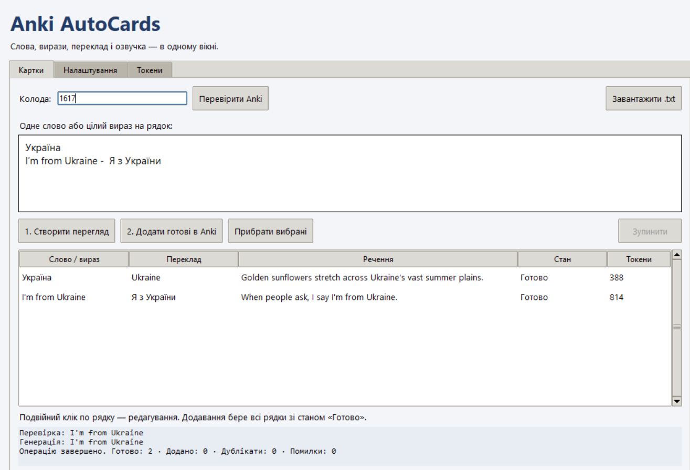

# Anki AutoCards



This is a non-commercial personal project that I developed for myself while learning English.
It makes creating and studying vocabulary flashcards more convenient for my own learning
workflow.

A Windows desktop application that turns English words and phrases into ready-to-use Anki
flashcards with Ukrainian translations, contextual example sentences, and audio.

[Anki](https://apps.ankiweb.net/) is a free, open-source flashcard app that uses spaced
repetition to help you remember information more effectively. If you are new to Anki, visit
the official website to download it and learn more about how it works.

It removes the repetitive work of looking up translations, writing examples, preparing audio, and copying data: users enter a word list, review the generated cards, and add them to Anki.

## Table of contents

- [Features](#features)
- [Tech stack](#tech-stack)
- [Usage](#usage)
- [Development](#development)
- [Testing](#testing)
- [Build and CI/CD](#build-and-cicd)
- [Contributing](#contributing)
- [FAQ](#faq)

## Features

- a translation, contextual sentence, and up to two audio tracks per card;
- editable preview before writing anything to Anki;
- duplicate detection before generation and again before insertion;
- custom translations in the `word — translation 1, translation 2` format;
- support for OpenAI, OpenRouter, Anthropic, and OpenAI-compatible APIs;
- input/output token usage for every attempt and the entire session;
- API key storage through Windows Credential Manager;
- automatic deck and note-type creation without overwriting existing templates.

| Metric | Value |
|---|---:|
| Content-generation attempts in the standard flow | 1 per card |
| Additional generation attempts when adding a ready preview | 0 |
| Maximum attempts after an invalid model response | 2 |
| Automated tests | 21 |
| CI matrix combinations | 4 |

```text
Word list → duplicate check → LLM → validation → preview → TTS → Anki
```

## Tech stack

Python, LangChain, LangGraph, AnkiConnect, Edge TTS, Pytest, Ruff, GitHub Actions

## Usage

### Requirements

- Windows and Python 3.10+;
- [Anki](https://apps.ankiweb.net/) with AnkiConnect (`2055492159`) installed and running;
- an API key for a supported LLM provider;
- an internet connection for LLM requests and text-to-speech.

### Quick start

1. Clone or download the repository.
2. Run `Start.bat` — it creates `.venv` and installs the dependencies.
3. Open **Settings** (`Налаштування`), select a provider and model, and enter your API key.
4. Paste your words and click **Create Preview** (`Створити перегляд`).
5. Review the results, open Anki, and click **Add Ready Cards to Anki**
   (`Додати готові в Anki`).

Example input:

```text
thrive
I'm all ears
look after — доглядати, піклуватися
```

## Development

### Install dependencies

```powershell
py -3 -m venv .venv
.\.venv\Scripts\python.exe -m pip install -r requirements-dev.txt
```

### Run the application

```powershell
.\.venv\Scripts\python.exe anki_autocards.py
```

Settings can be configured through the UI or by copying `.env.example` to `.env`.
The `.env` file containing secrets is excluded from Git.

### Project structure

```text
app.py             # Tkinter UI and card preview
workflow.py        # LangChain/LangGraph workflow, retries, and token tracking
anki_core.py       # AnkiConnect, prompts, validation, HTML, and TTS
settings.py        # Configuration and secure API key storage
tests/             # Automated tests
```

## Testing

The project has 21 automated tests. They do not require real API keys or Anki: external
services are replaced with controlled implementations, while the OpenAI-compatible client
is tested against a local HTTP server.

```powershell
.\.venv\Scripts\python.exe -m ruff check .
.\.venv\Scripts\python.exe -m ruff format --check .
.\.venv\Scripts\python.exe -m pytest -q
```

## Build and CI/CD

Run `Build_EXE.bat` to create the Windows build. Output:

```text
dist\AnkiAutoCards\AnkiAutoCards.exe
```

Distribute the entire `dist\AnkiAutoCards` directory. Python is not required on the target
computer, but Anki, AnkiConnect, and an internet connection are still required.

On every push and pull request, GitHub Actions runs Ruff and Pytest across this matrix:

- Windows and Ubuntu;
- Python 3.10 and 3.12.

## Contributing

1. Create a separate branch for your change.
2. Add or update tests.
3. Run Ruff and Pytest locally.
4. Open a pull request with a concise description of the problem and solution.

For bug reports, include your Python version, provider, model, reproduction steps, and error
message. Never include API keys or other secrets.

## FAQ

### Can I preview cards without running Anki?

Yes. Anki is required for duplicate checks and card insertion, but not for preview generation.

### Is the LLM called again when I add a ready card?

No. The application reuses the result stored in the current preview.

### Where is the API key stored?

If enabled by the user, it is stored in Windows Credential Manager through `keyring`.
The key is never written to `settings.json`.


